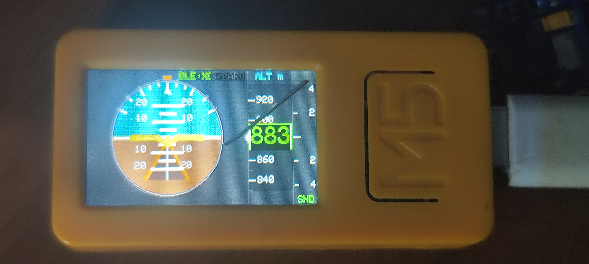

# ✈️ M5StickC Plus 2 Aviation Avionics & Audio Variometer

<p align="center">
  🌐 <b>English</b> | <a href="README_PT.md">Português (Brasil)</a>
</p>

[](https://platformio.org/)
[](https://m5stack.com/)
[](https://www.te.com/)
[](https://xctrack.org/)
[](LICENSE)

<p align="center">
  
  <br>
  <em><b>M5StickC Plus 2</b> running the Primary Flight Display (PFD) with artificial horizon, tape altimeter, vertical speed indicator (VSI), and active BLE telemetry.</em>
</p>

A precision civil aviation primary flight display (PFD) simulator and high-accuracy acoustic variometer designed for free flight (paragliding, hang gliding, sailplanes, and ultralights) running on the wrist-wearable **M5StickC Plus 2 (M5-Watch)**. Featuring a **GY-63 (MS5611)** high-resolution barometric altimeter and integrated **Bluetooth Low Energy (BLE)** real-time telemetry streaming for **XCTrack** and **XCSoar**.

Inspired by classic cockpit avionics and Mirko Pavleski's *DIY Avionics Simulator*, re-engineered with high-performance double-buffered rendering (35–40 FPS, 100% flicker-free).

---

## 🌟 Key Features

* **Glass Cockpit Primary Flight Display (PFD)**:
  * Dynamic artificial horizon with 5° pitch ladder, roll scale with bank indicator triangle, and 3D perspective runway.
  * Aircraft reference waterline crosshair (*yellow miniature airplane*).
  * Rolling tape altimeter with high-contrast digits and digital readout drum.
  * Real-time above-ground-level take-off reference altitude (**AGL**).
  * Vertical Speed Indicator (**VSI**) bar with graduated climb/sink scale.
* **Multiple Display Modes**:
  * **Mode 0**: Complete PFD Cockpit (Horizon + Altimeter Tape + VSI + Battery & BLE Status).
  * **Mode 1**: Fullscreen Horizon with Tactical HUD Overlay.
  * **Mode 2**: Classic 3-Pointer Analog Altimeter (hundreds, thousands, and ten-thousands of meters/feet) with central digital window.
  * **Mode 3**: Interactive In-Flight Altitude Calibration Menu with step-by-step adjustment and non-volatile NVS flash memory storage.
* **Intelligent Acoustic Thermal Variometer**:
  * Thermal lift audio beeps with progressive cadence/pitch and continuous severe sink alarm tone.
  * **Zero-drift Deadband**: complete silence when stationary on a table (no false climb/sink beeps).
  * Dedicated single-click toggle for instant Mute / Audio (**MUTE / SND**).
* **Dynamic Leveling & In-Flight Zeroing**:
  * **Power-On Auto-Tare**: automatically levels flight attitude (0° pitch, 0° roll) in whatever resting angle the watch is placed.
  * **Quick In-Flight Attitude Re-Tare**: hold the front button at any moment to instantly re-level the horizon to your current arm/flight deck position.
  * **AGL Take-Off Tare (AGL = 0m)**: reset your takeoff altitude reference with a single click.
* **High-Rate Bluetooth Low Energy (BLE) Telemetry**:
  * Continuous **10Hz** transmission of standard `$LK8EX1` sentences (raw barometric pressure, baro altitude, vertical speed in cm/s, temperature, battery voltage).
  * Compatible with **XCTrack**, **XCSoar**, **Flyme**, **LK8000**, and **SeeYou Navigator**.
  * Auto-discovery via Nordic UART Service (NUS).

---

## 🛠️ Hardware & Wiring

| Component | Description | Connection to M5StickC Plus 2 |
| :--- | :--- | :--- |
| **M5StickC Plus 2** | ESP32-PICO-V3-02 MCU, 240x135 IPS Display, Buzzer, 6-Axis IMU, LiPo Battery | Main Watch Unit |
| **GY-63 Module (MS5611)** | Ultra-high resolution barometric pressure sensor (10–20 cm precision) | **Grove Port A (Red/Black connector)** |

### Grove Port A Pinout (M5StickC Plus 2):
* **Yellow Wire (SDA)**: `GPIO 32`
* **White Wire (SCL)**: `GPIO 33`
* **Red Wire (VCC)**: `5V` *(boost circuit powered directly from internal PMIC)*
* **Black Wire (GND)**: `GND`

> 💡 **Sensor Fail-Safe Note**: The firmware auto-probes I2C addresses `0x77` and `0x76` at 100/400 kHz with automatic background reconnection. If the sensor is unplugged, the instrument remains rock-solid at reference altitude, without jitter and 100% silent.

---

## 🎮 Button Controls Guide

The M5StickC Plus 2 features 3 physical buttons:
* **Button A (Front M5)**: GPIO 37
* **Button B (Lower Side)**: GPIO 39
* **Button PWR / C (Upper Side / Power)**: GPIO 35

```
+------------------------------------------------------+
| [PWR/C] (Upper Side Button)                          |
|                                                      |
|   +-----------------------+      +---------------+   |
|   |                       |      |               |   |
|   |       LCD DISPLAY     |      |    [Btn A]    |   |
|   |        240 x 135      |      |    (Front)    |   |
|   |                       |      |               |   |
|   +-----------------------+      +---------------+   |
|                                                      |
| [Btn B] (Lower Side Button)                          |
+------------------------------------------------------+
```

### 1. In-Flight Modes (PFD / HUD / Dial)

| Button | Action | Function |
| :--- | :--- | :--- |
| **Button A (Front M5)** | **Short Press (Click)** | **Mute / Unmute**: Instantly toggles variometer audio sound ON/OFF (with audio chime & screen toast). |
| **Button A (Front M5)** | **Hold for 3s** | **ZERO (AGL 0m / Level)**: Sets current altitude as takeoff zero reference (`AGL = 0m`) and levels the artificial horizon to your current arm orientation. |
| **Button A (Front M5)** | **Double Click** | **Toggle DEMO Mode**: Activates/deactivates simulated thermal flight. |
| **Button B (Side)** | **Short Press (Click)** | **Cycle Displays**: Loops between `PFD Cockpit` ➔ `Horizon HUD` ➔ `Analog Dial`. |
| **Button B (Side)** | **Hold (> 1s)** | **Calibration Menu**: Opens the interactive fine-tuning altitude menu. |
| **Button B (Side)** | **Double Click** | **Toggle DEMO Mode** (Secondary shortcut). |
| **Button PWR (Side)** | **Short Press (Click)** | **Zero AGL Altitude**: Quick shortcut to reset relative altitude to 0m. |

### 2. Mode 3: Interactive Altitude Calibration Menu

Upon entering the Calibration Menu, adjustments start at current integer altitude:

| Button | Action | Function |
| :--- | :--- | :--- |
| **Button A (Front M5)** | **Short Press (Click)** | **+1 meter (+1m)** target altitude. |
| **Button B (Side)** | **Short Press (Click)** | **-1 meter (-1m)** target altitude. |
| **Button A (Front M5)** | **Hold (> 1s)** | **SAVE**: Commits target altitude to Flash NVS, recalibrates sea-level QNH, and returns to PFD. |
| **Button PWR (Side)** | **Short Press (Click)** | **CANCEL**: Exits menu without saving. |

---

## 📱 Connecting to XCTrack (Android)

1. Turn on the M5StickC Plus 2. The top bar will display `BLE:ADV`.
2. Open **XCTrack** on your Android smartphone or tablet.
3. Go to **Preferences** ➔ **Connection & Sensors** ➔ **External Sensor**.
4. Choose **Bluetooth LE (Low Energy)**.
5. Tap **Scan** and select **`M5-VARIO`**.
6. The protocol is automatically identified as **Nordic UART / LK8EX1**.
7. The status bar on the M5StickC will change to **`BLE:XCT`** in green, streaming 10Hz altitude and climb/sink data in real time!

---

## 💻 Build & Flash with PlatformIO

### Prerequisites
* [Visual Studio Code](https://code.visualstudio.com/) with the **PlatformIO IDE** extension installed.
* USB-C cable connected to the M5StickC Plus 2.

### Terminal Commands
```bash
# Clone and enter the repository folder
cd c:/_MAA/Desenv/ESP32C3_BLUETOOTH_AUDIO_VARIO-main

# Build firmware for the M5StickC Plus 2 environment
pio run -e m5stickc_plus2

# Upload to the connected device (e.g. COM8)
pio run -e m5stickc_plus2 -t upload --upload-port COM8

# Open serial monitor to inspect boot diagnostics
pio device monitor -p COM8 -b 115200
```

---

## ⚡ 1-Click Fast Flashing (PowerShell)

To burn the complete firmware directly at maximum speed (1,500,000 baud) without manual recompilation:

```powershell
.\flash_m5stickc.ps1 -port COM8
```

---

## 🏪 M5Burner & Marketplace Publishing

The **M5Burner** is the official M5Stack firmware repository and burner application.

### Step 1: Generate the Monolithic All-In-One Binary (.bin)
M5Burner flashes a single combined binary at address `0x0000`. You can build and merge all 4 partitions automatically:

```bash
# Builds, merges with esptool, and registers in local M5Burner
py -3.11 generate_m5burner_bin.py
```

*Generated file:* [`m5stickc_plus2_vario_m5burner.bin`](file:///c:/_MAA/Desenv/ESP32C3_BLUETOOTH_AUDIO_VARIO-main/m5stickc_plus2_vario_m5burner.bin) (offset `0x0000`, 8MB flash).

Or manually via `esptool`:
```bash
python -m esptool --chip esp32 merge-bin -o m5stickc_plus2_vario_m5burner.bin --flash-mode dio --flash-freq 40m --flash-size 8MB 0x1000 .pio/build/m5stickc_plus2/bootloader.bin 0x8000 .pio/build/m5stickc_plus2/partitions.bin 0xe000 ~/.platformio/packages/framework-arduinoespressif32/tools/partitions/boot_app0.bin 0x10000 .pio/build/m5stickc_plus2/firmware.bin
```

### Step 2: Publish to the M5Burner Global Catalog
1. Download and open [M5Burner](https://m5stack.com/pages/download).
2. Log in with your M5Stack community account.
3. In the sidebar, select **STICKC**.
4. Click **Publish** (or **Custom** / **Upload**).
5. Fill in the package details:
   * **Title**: `M5StickC Plus 2 Avionics Horizon & Variometer`
   * **Category**: `Aviation` / `Sensors`
   * **Device**: `M5StickC Plus 2`
   * **Description**: Primary flight display, barometric variometer, BLE telemetry.
   * **Screenshots**: Attach [`docs/IMG_20261014_192710.jpg`](file:///c:/_MAA/Desenv/ESP32C3_BLUETOOTH_AUDIO_VARIO-main/docs/IMG_20261014_192710.jpg).
   * **Firmware File**: Select `m5stickc_plus2_vario_m5burner.bin`.
6. Submit for validation.

---

## 🚀 Pushing to GitHub

To update your GitHub repository:

```bash
# 1. Stage changes
git add .

# 2. Commit
git commit -m "docs: add prominent device hero photo and dual-language READMEs (EN/PT-BR)"

# 3. Push to remote
git push -u origin main
```

---

## 📜 License & Credits

* **Artificial Horizon Algorithm**: Inspired by Mirko Pavleski's *DIY Avionics Simulator* ([Project Hub](https://projecthub.arduino.cc/mircemk/diy-avionics-simulator-with-esp32-artificial-horizon-compass-altimeter-f39fac)).
* **Kalman 4D Fusion Filter**: KF4D algorithm adapted from *ESP32_IMU_GPS_BARO_VARIO* by [har-in-air](https://github.com/har-in-air/ESP32_IMU_BARO_GPS_VARIO).
* **Core Libraries**: [M5Unified](https://github.com/m5stack/M5Unified), [M5GFX](https://github.com/m5stack/M5GFX), [NimBLE-Arduino](https://github.com/h2zero/NimBLE-Arduino).
* **License**: MIT. Free to use, adapt, and share!
